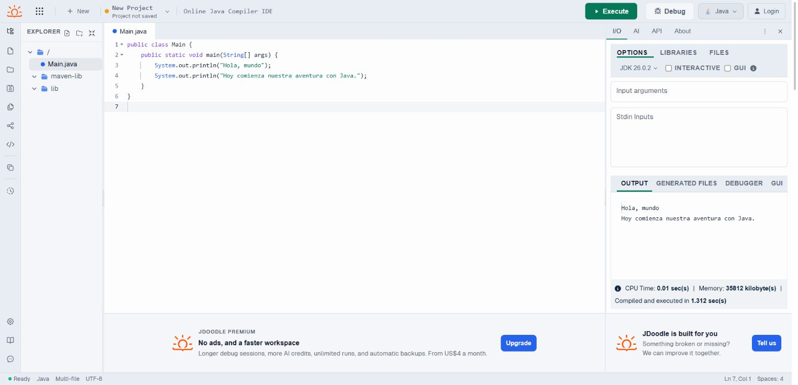
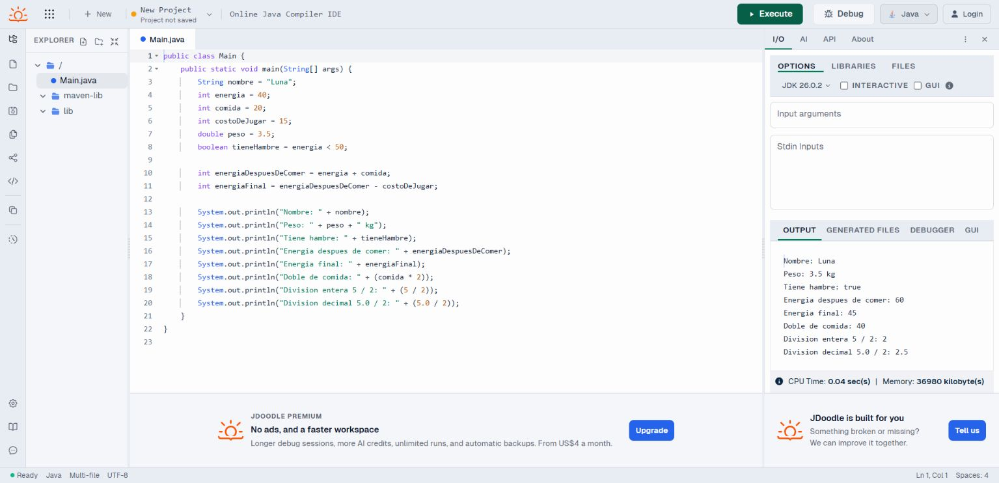
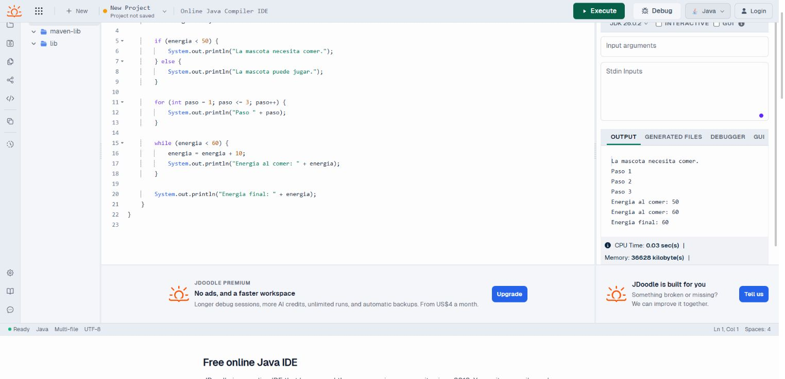
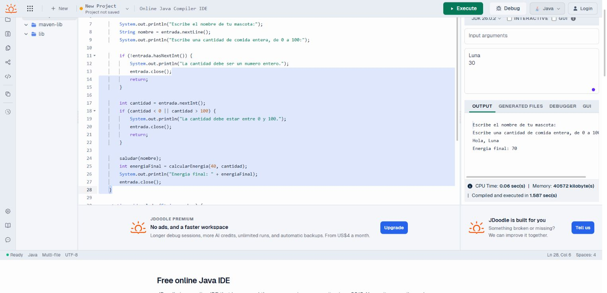
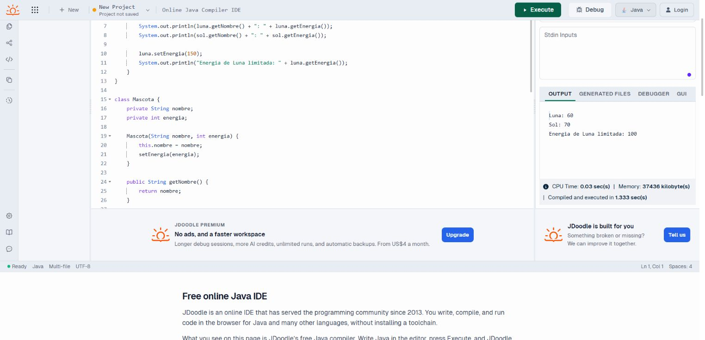
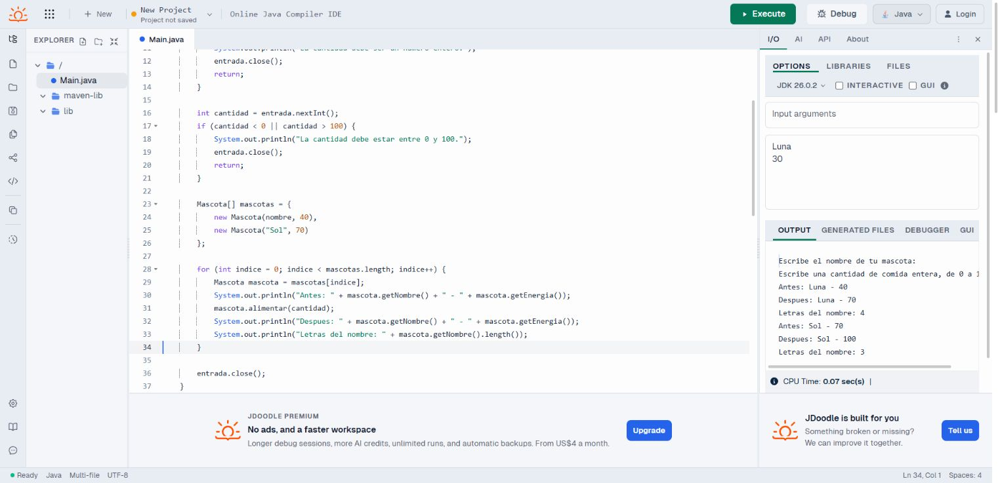

# Pantallas del curso Java

Estas capturas muestran los seis ejemplos ejecutados en JDoodle. Consulta el [plan del curso](../course-plan.md) para encontrar los tiempos y prácticas de cada lección.

## 1. Hola, mundo

## 2. Variables y operadores

## 3. Decisiones y bucles

## 4. Métodos y Scanner

## 5. Clases y encapsulación

## 6. Arrays y proyecto final

